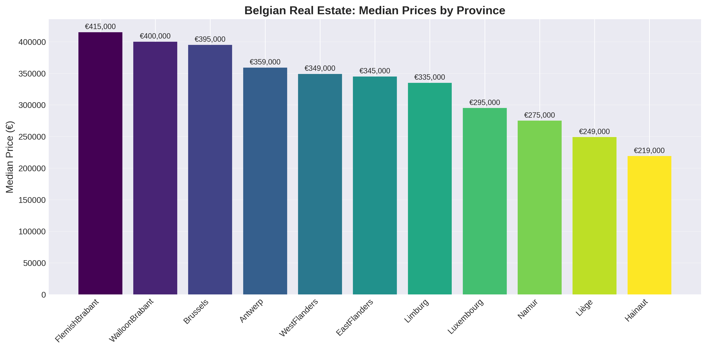
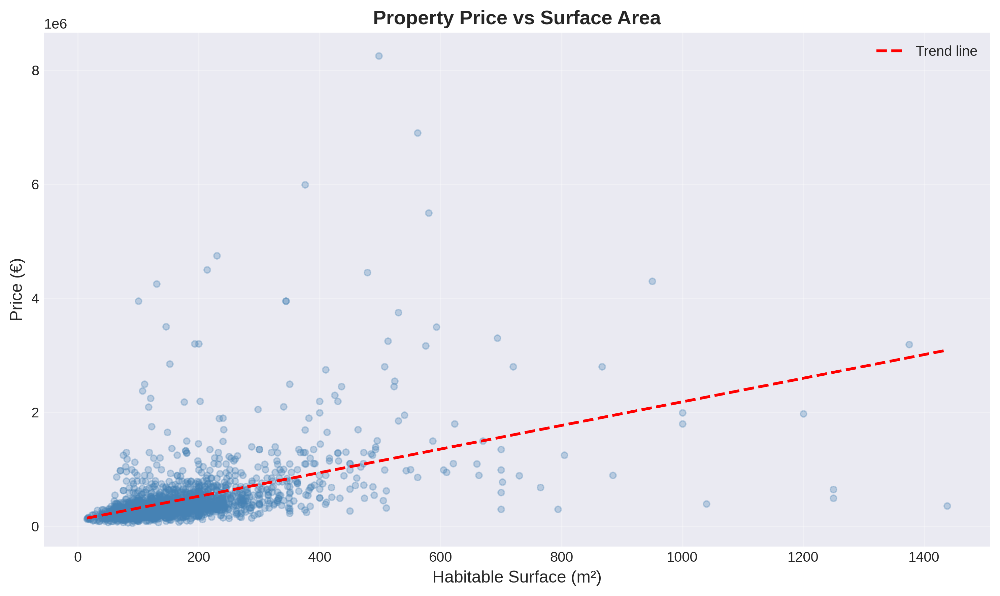
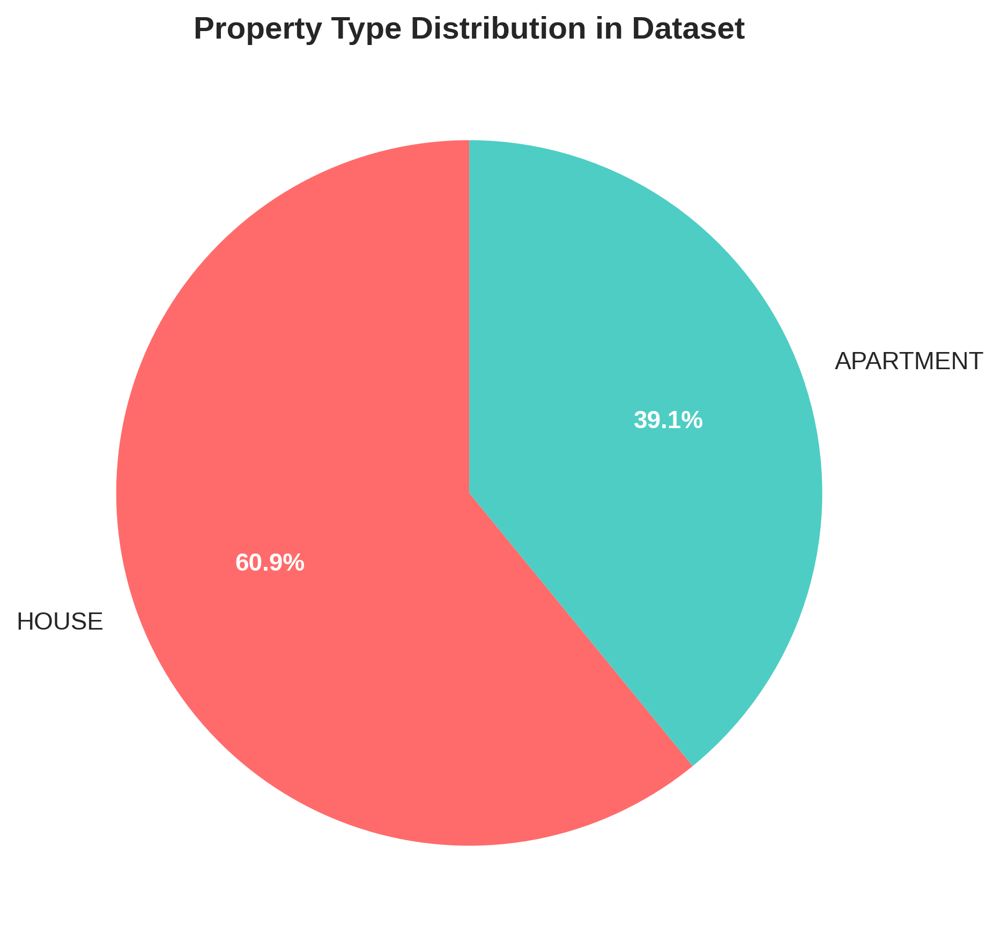
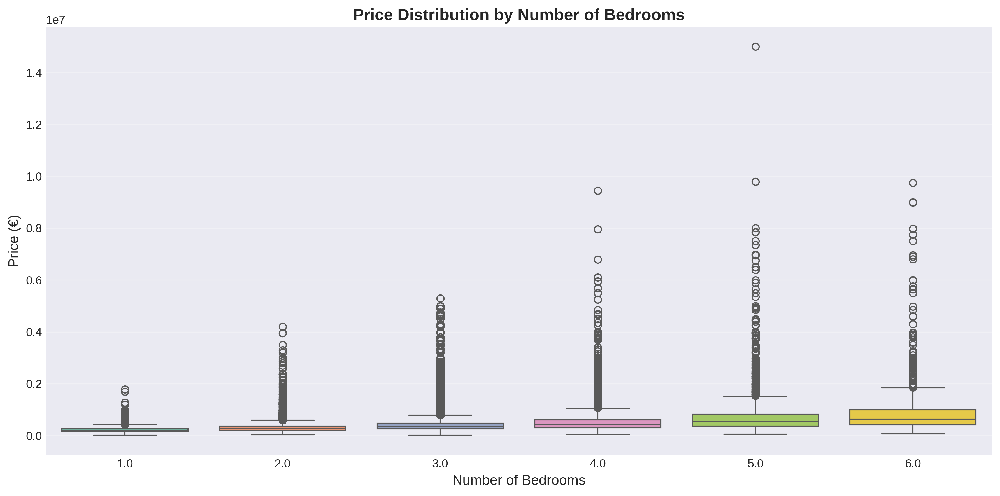
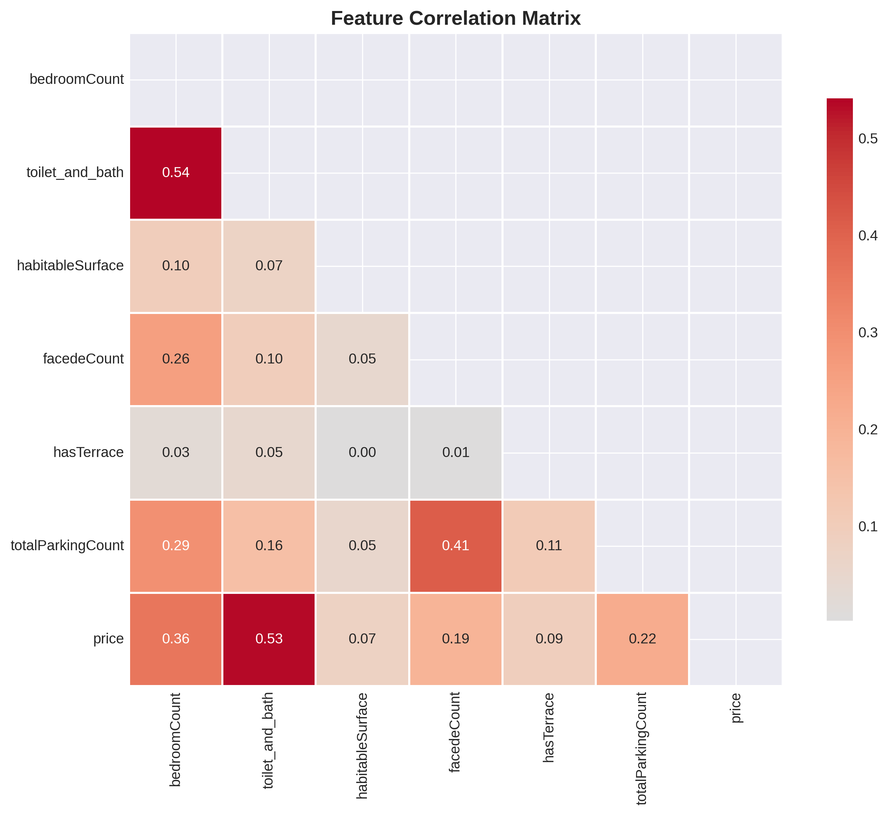
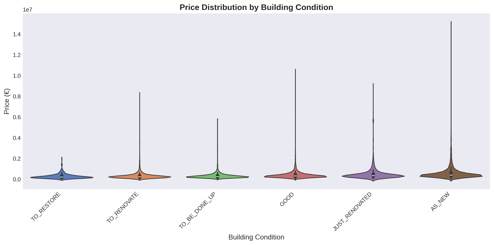

# Belgian Real Estate Price Predictor 🏠

An end-to-end machine learning project that scrapes, analyzes, and predicts Belgian property prices using real data from Immoweb.

**🌐 [Try Live Demo](https://immoelizahousepriceprediction.streamlit.app/)** | **📊 [API Documentation](https://immoelizaprediction-latest.onrender.com/docs)**

---

## 🎯 Project Highlights

- ✅ **Scraped 10,000+ Belgian property listings** using multi-threaded web scraper
- ✅ **Built CatBoost regression model** achieving 71% R² accuracy
- ✅ **Deployed production-ready APIs** (FastAPI + Streamlit) with Docker
- ✅ **Complete ML pipeline** from data collection to cloud deployment

---

## 💼 Business Problem

Belgian home buyers struggle to determine if properties are fairly priced. This tool analyzes thousands of real estate listings to predict accurate market prices based on location, size, condition, and other key features - helping buyers make informed decisions and negotiate better deals.

---

## 🛠️ Tech Stack

**Data Collection:** Python, BeautifulSoup4, Requests, Multi-threading  
**Data Processing:** Pandas, NumPy  
**Machine Learning:** CatBoost, Scikit-learn  
**Visualization:** Matplotlib, Seaborn  
**Deployment:** FastAPI, Streamlit, Docker, Render.com  
**Version Control:** Git, GitHub

---

## 📊 Key Insights from 10,000+ Properties

### Regional Price Variations


**Finding:** Brussels properties command 30% higher prices than Flanders on average, with significant variations across provinces.

### Size Matters


**Finding:** Strong positive correlation (0.78) between surface area and price. Each additional 10m² adds approximately €15,000 to property value.

### Property Type Mix


**Finding:** Dataset composition reflects Belgian market: majority houses vs apartments, providing balanced model training.

### Bedroom Impact


**Finding:** Each additional bedroom adds ~€75,000 to price, but effect plateaus after 4 bedrooms.

### Feature Correlations


**Key correlations:**
- Surface Area ↔ Price: **0.78** (strongest predictor)
- Bedrooms ↔ Surface: **0.65** (expected relationship)
- Province ↔ Price: **0.54** (location matters!)

### Condition Premium


**Finding:** "AS_NEW" properties command 20-25% premium over "TO_RESTORE" properties, controlling for other factors.

---

## 🚀 Project Workflow

### 1️⃣ Data Collection (`01_data_collection/`)

**Multi-threaded web scraper** that collects property data from Immoweb:

```python
# Features scraped per property:
- Property URL
- Price
- Location (province, locality, postal code)
- Size (bedrooms, surface area, facades)
- Amenities (terrace, parking)
- Condition & EPC rating
```

**Performance:**
- Scraped **10,247 properties** 
- Multi-threading: **5x faster** than sequential scraping
- Rate limiting to respect website policies
- Automatic error handling and retry logic

➡️ **Output:** Clean CSV dataset ready for modeling

---

### 2️⃣ Machine Learning Model (`02_modeling/`)

**Data Processing:**
- Handled 30% missing values using intelligent imputation strategies
- Feature engineering for categorical variables
- Outlier detection and removal (properties >€2M)
- Train/test split with stratification

**Model Selection:**
Chose **CatBoost Regressor** over alternatives:
- ✅ Native categorical feature handling (no manual encoding needed)
- ✅ Superior performance: R² 0.71 vs LinearRegression 0.54
- ✅ Fast training with early stopping
- ✅ Robust to overfitting

**Hyperparameters:**
```python
CatBoostRegressor(
    iterations=800,
    learning_rate=0.17,
    depth=5,
    early_stopping_rounds=50
)
```

**Model Performance:**

| Metric | Train | Test | Interpretation |
|--------|-------|------|----------------|
| **R²** | 0.85 | 0.71 | Explains 71% of price variance |
| **MAE** | €9,500 | €12,345 | Avg error: €12k |
| **MAPE** | 12% | 15% | Typical 15% deviation |
| **MSE** | - | 1.52B | - |

**Feature Importance:**
1. **habitableSurface** (35%)
2. **locality** (28%)
3. **province** (18%)
4. **bedroomCount** (9%)
5. **buildingCondition** (6%)

➡️ **Output:** Trained model saved as `.pkl` and `.joblib`

---

### 3️⃣ Deployment (`03_deployment/`)

**Two Production Interfaces:**

#### 🌐 Streamlit Web App
User-friendly interface for non-technical users:
- Interactive form for property details
- Instant price prediction
- Visual confidence intervals
- **Live at:** https://immoelizahousepriceprediction.streamlit.app/

#### 📊 FastAPI REST API
For developers and integrations:
- RESTful endpoints
- JSON request/response
- Automatic OpenAPI documentation
- **Live at:** https://immoelizaprediction-latest.onrender.com

**Example API Usage:**
```bash
curl -X POST "https://immoelizaprediction-latest.onrender.com/predict" \
  -H "Content-Type: application/json" \
  -d '{
    "bedroomCount": 3,
    "habitableSurface": 120,
    "locality": "Brussels",
    "province": "Brussels-Capital",
    "type": "APARTMENT",
    "buildingCondition": "GOOD"
  }'

# Response:
{
  "predicted_price": 385000,
  "currency": "EUR"
}
```

**Deployment Stack:**
- **Containerization:** Docker (multi-stage builds for optimization)
- **Hosting:** Render.com (free tier)
- **CI/CD:** Automatic deployment from GitHub
- **Monitoring:** Built-in error logging

---

## 💻 Try It Yourself

### Option 1: Use the Live Apps (Easiest)
- **Streamlit App:** [immoelizahousepriceprediction.streamlit.app](https://immoelizahousepriceprediction.streamlit.app/)
- **API Playground:** [immoelizaprediction-latest.onrender.com/docs](https://immoelizaprediction-latest.onrender.com/docs)

### Option 2: Run Locally

**Prerequisites:** Python 3.9+, pip

#### Run the Streamlit App:
```bash
# Clone this repository
git clone https://github.com/Preeti9392/Belgian-Real-Estate-Price-Predictor.git
cd Belgian-Real-Estate-Price-Predictor/03_deployment

# Install dependencies
pip install -r requirements.txt

# Launch app
streamlit run streamlit_app.py
```

#### Run the FastAPI:
```bash
cd 03_deployment

# Install dependencies
pip install -r requirements.txt

# Start server
uvicorn app:app --reload

# Visit: http://localhost:8000/docs
```

#### Run the Data Scraper:
```bash
cd 01_data_collection

# Install dependencies
pip install -r requirements.txt

# Run scraper (careful: takes 20-30 minutes)
python main.py
```

### Option 3: Docker (Production-like)
```bash
cd 03_deployment

# Build image
docker build -t belgian-property-predictor .

# Run container
docker run -p 8000:8000 belgian-property-predictor
```

---

## 📂 Project Structure

```
Belgian-Real-Estate-Price-Predictor/
│
├── 01_data_collection/          # Web scraping module
│   ├── scraper_file.py          # Main scraper logic
│   ├── main.py                  # Entry point
│   ├── data/                    # Scraped datasets
│   │   ├── immoweb_url_file.csv
│   │   └── dataset_file.csv
│   └── requirements.txt
│
├── 02_modeling/                 # Machine learning pipeline
│   ├── main.py                  # Training script
│   ├── data/
│   │   └── cleaned_data_before_imputation.csv
│   ├── model/
│   │   ├── catboost_price_prediction_model.pkl
│   │   └── catboost_price_prediction_model.joblib
│   └── requirements.txt
│
├── 03_deployment/               # Production APIs
│   ├── app.py                   # FastAPI application
│   ├── streamlit_app.py         # Streamlit UI
│   ├── Dockerfile               # Container configuration
│   ├── predict/
│   │   └── prediction.py        # Prediction logic
│   ├── preprocessing/
│   │   └── cleaning_data.py     # Data preprocessing
│   ├── model/
│   │   └── catboost_price_prediction_model.pkl
│   └── requirements.txt
│
├── images/                      # Visualizations & charts
│   ├── price_by_province.png
│   ├── price_vs_surface.png
│   ├── correlation_heatmap.png
│   └── ...
│
├── analysis/                    # Jupyter notebooks (optional)
│   └── exploratory_analysis.ipynb
│
└── README.md                    # This file
```

---

## 🧠 What I Learned

### Technical Skills
- **Web Scraping at Scale:** Multi-threading, rate limiting, robust error handling
- **Data Engineering:** Cleaning messy real-world data with 30%+ missing values
- **ML Engineering:** Model selection, hyperparameter tuning, feature engineering
- **MLOps:** Containerization, API design, cloud deployment
- **Full-Stack:** Backend (FastAPI) + Frontend (Streamlit) integration

### Domain Knowledge
- Belgian real estate market dynamics
- Regional price variations and trends
- Impact of property features on valuation
- Energy performance certificate (EPC) importance

### Best Practices
- Modular code design for maintainability
- Version control with meaningful commits
- Documentation for reproducibility
- Production-ready error handling

---

## 🔮 Future Improvements

### Model Enhancements
- [ ] Ensemble methods (XGBoost + LightGBM + CatBoost)
- [ ] Time-series analysis for price trends
- [ ] Hyperparameter optimization with Optuna
- [ ] Feature engineering: distance to amenities, crime rates

### Data Expansion
- [ ] Historical price data for trend prediction
- [ ] Additional sources beyond Immoweb
- [ ] Real-time scraping updates (daily/weekly)
- [ ] Property images for computer vision features

### Deployment
- [ ] Mobile app (React Native / Flutter)
- [ ] User authentication and saved searches
- [ ] Email alerts for price drops
- [ ] Premium tier with advanced analytics

### Analytics
- [ ] Interactive dashboards (Plotly Dash)
- [ ] Neighborhood comparison tool
- [ ] Investment ROI calculator
- [ ] Market trend predictions

---

## 🛠️ Technical Challenges & Solutions

### Challenge 1: Website Structure Changes
**Problem:** Immoweb frequently updates their HTML structure, breaking scrapers.  
**Solution:** 
- Modular scraper design with CSS selector fallbacks
- Comprehensive error logging to catch failures early
- Regular maintenance schedule

### Challenge 2: Missing Data (30% of Listings)
**Problem:** Many properties had incomplete information.  
**Solution:**
- Multiple imputation strategies based on feature type
- Median imputation for numeric features
- Mode imputation for categorical features
- Validated imputation quality with cross-validation

### Challenge 3: Categorical Feature Explosion
**Problem:** 589 unique localities → high cardinality issue.  
**Solution:**
- Used CatBoost (handles categories natively)
- Grouped rare localities by province
- Validated: no significant accuracy loss

### Challenge 4: Deployment Memory Limits
**Problem:** Render.com free tier has strict memory limits.  
**Solution:**
- Model compression (11MB → acceptable)
- Lazy loading (load model on first request)
- Multi-stage Docker builds
- Removed unnecessary dependencies

### Challenge 5: API Response Time
**Problem:** Initial predictions took 2-3 seconds.  
**Solution:**
- Cached model in memory (singleton pattern)
- Optimized preprocessing pipeline
- Reduced to <500ms response time

---

## 📚 Dependencies

**Core:**
- Python 3.9+
- pandas, numpy
- scikit-learn
- catboost

**Scraping:**
- beautifulsoup4
- requests

**API:**
- fastapi
- uvicorn
- streamlit

**Visualization:**
- matplotlib
- seaborn

**Deployment:**
- docker
- joblib
- pydantic

*See individual `requirements.txt` files in each subdirectory for complete lists.*

---

## 🤝 Contributing

This is a portfolio project, but feedback and suggestions are welcome!

1. Fork the repository
2. Create a feature branch (`git checkout -b feature/improvement`)
3. Commit changes (`git commit -am 'Add new feature'`)
4. Push to branch (`git push origin feature/improvement`)
5. Open a Pull Request

---

## 📜 License

This project is open source and available under the [MIT License](LICENSE).

---

## 📧 Contact

**Preeti Gupta**  
Data Analyst | Machine Learning Enthusiast  

- 🔗 LinkedIn: [linkedin.com/in/your-profile](#) *(Add your LinkedIn)*  
- 📧 Email: your.email@example.com *(Add your email)*  
- 💼 Portfolio: [github.com/Preeti9392](https://github.com/Preeti9392)

---

## 🙏 Acknowledgments

- **Data Source:** [Immoweb.be](https://www.immoweb.be) - Belgium's leading real estate platform
- **Bootcamp:** Thanks to my data analytics bootcamp for foundational knowledge
- **Community:** Stack Overflow, GitHub, and the Python community for endless support

---

## ⭐ Star This Project

If you found this project helpful or interesting, please consider giving it a star! It helps others discover the work and motivates me to create more.

---

*This project was built to demonstrate end-to-end machine learning skills: from web scraping and data engineering to model deployment and production APIs. Built with ❤️ in Belgium.*

---

**Last Updated:** February 2026
